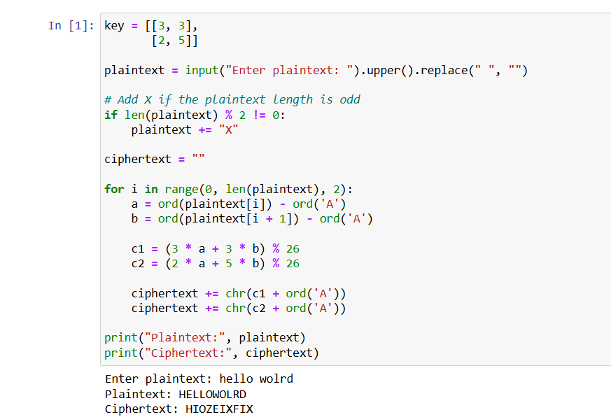

# Lab-Exercise---3---Hill-Cipher
## Aim:
To develop a simple C program to implement Hill

## Procedure:
1. Design of Hill Cipher 
2. Implementation using C or python code 
3. Testing algorithm with different key values. ALGORITHM DESCRIPTION: The Hill cipher is a 
substitution cipher invented by Lester S. Hill in 1929. Each letter is represented by a 
number modulo 26.
4. To encrypt a message, each block of n letters is multiplied by an invertible n × n 
matrix, again modulus 26.
5. To decrypt the message, each block is multiplied by the inverse of the 
matrix used for encryption.
6. The matrix used for encryption is the cipher key, and it should be 
chosen randomly from the set of invertible n × n matrices (modulo 26).
7. The cipher can, be adapted to an alphabet with any number of letters.
8. All arithmetic just needs to be done modulo the number of letters instead of modulo.

## program:
```
key = [[3, 3],
       [2, 5]]

plaintext = input("Enter plaintext: ").upper().replace(" ", "")

# Add X if the plaintext length is odd
if len(plaintext) % 2 != 0:
    plaintext += "X"

ciphertext = ""

for i in range(0, len(plaintext), 2):
    a = ord(plaintext[i]) - ord('A')
    b = ord(plaintext[i + 1]) - ord('A')

    c1 = (3 * a + 3 * b) % 26
    c2 = (2 * a + 5 * b) % 26

    ciphertext += chr(c1 + ord('A'))
    ciphertext += chr(c2 + ord('A'))

print("Plaintext:", plaintext)
print("Ciphertext:", ciphertext)
```
## Output:

## Result:
The program is executed successfully.